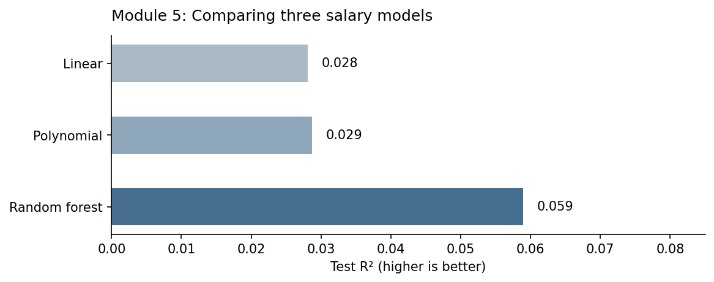

# My Projects

These are a few things I worked on in my AD688 class. I'm keeping the explanations simple and focusing on what I actually did.

::: {.project-card}
## Salary Prediction with Spark (Module 5)

I used PySpark to work with job posting data and tried three models to predict salaries: linear regression, polynomial regression, and random forest.

I started with more than 800,000 job records. After cleaning the salary data, I used a sample to train and test the models. Random forest had the lowest test error, but the results also showed that predicting salaries is not easy with just a few features.

{fig-alt="A simple bar chart of test R-squared for linear regression, polynomial regression, and random forest." width="85%"}

[View the Module 5 GitHub repository](https://github.com/met-ad-688/688-f26-a1-m05-a-irgengu-ai)
:::

::: {.project-card}
## Working with Job Data in Spark (Module 3)

I worked with job posting data stored in Parquet files. I used PySpark to load the data, check the columns, and explore what the dataset could tell me. This helped me get more comfortable working with data that was too large to inspect manually.

[View the Module 3 GitHub repository](https://github.com/met-ad-688/688-f26-a1-m03-a-irgengu-ai)
:::

::: {.project-card}
## SQL Practice (Module 2)

I used SQL to answer questions from structured data. I practiced writing queries and organizing the results so they were easier to understand. It was a useful way to connect what I learned in class with business questions.
:::

::: {.project-card}
## Setting Up AWS EC2 (Module 1)

At the beginning of the semester, I set up an EC2 instance and connected to it from my computer. I also worked with VS Code, GitHub, and Quarto. The setup took some trial and error, but it helped me run my later assignments on AWS.
:::
